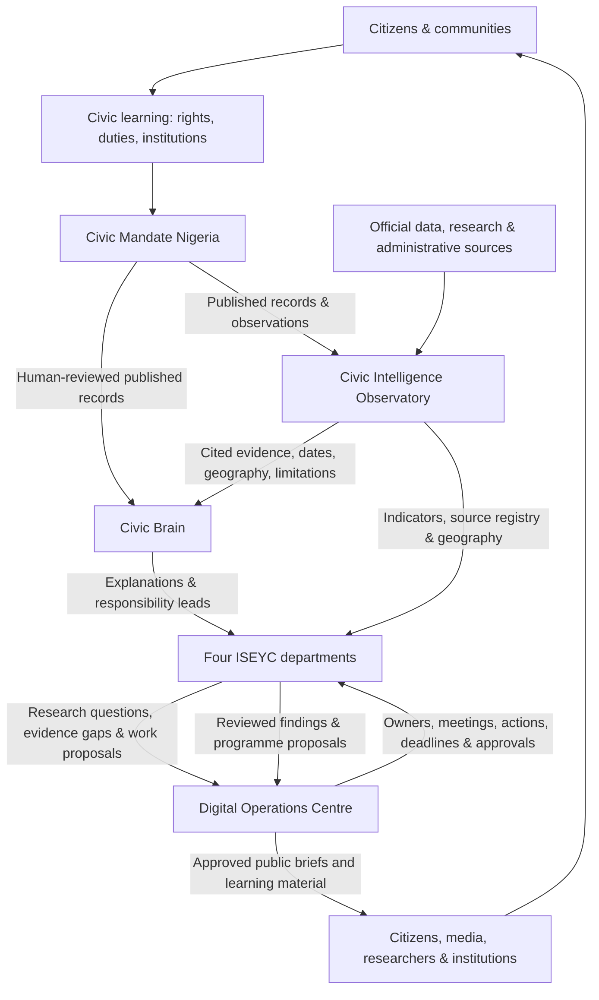

# ISEYC National Civic Intelligence Architecture

**Architecture version:** 2.0  
**Review date:** 9 November 2026  
**Purpose:** One connected institutional system, with clear product ownership and department accountability.

## 1. The operating model

Citizens understand their rights and responsibilities, report what they experience, and explore what public evidence says. ISEYC reviews, interprets and explains the record. Departments investigate the evidence and develop responsible responses. The Digital Operations Centre coordinates the people, deadlines, decisions and publications behind that work.

## 2. Product ownership

| Product | Primary responsibility | Must not become |
|---|---|---|
| **Civic Mandate Nigeria** | Citizen entry: civic learning, observations, public-service demands, human review and published community records | A petition counter, poll, prevalence survey or campaign tool |
| **Civic Brain** | Evidence retrieval, explanation, uncertainty, institutional responsibility mapping and draft briefs with citations | An autonomous decision-maker, government-contact bot or source of invented statistics |
| **Civic Intelligence Observatory** | National evidence foundation: source registry, indicators, snapshots, geography, departments, accountability and public exploration | A dashboard of unsupported projections or a directory that claims every source is integrated |
| **Digital Operations Centre** | Internal operating control: officers, work plans, meetings, decisions, actions, communications, approvals, evidence and follow-up | A public intelligence source or a replacement for departmental expertise |

### The evidence loop

1. **Mandate listens.** A citizen learns, observes, reports or tracks a published issue.
2. **Human review protects the public record.** Submission does not mean publication; publication does not mean independent verification.
3. **Observatory supplies context.** Every statistic retains its publisher, reference period, geography, method and limitations.
4. **Brain explains.** It separates source facts, community claims, estimates, research findings and unknowns.
5. **Departments investigate.** Officers turn evidence gaps into research questions, field checks and programme options.
6. **DCC coordinates.** Named owners, deadlines, meeting decisions, evidence and approval records keep the work accountable.
7. **ISEYC explains back.** Approved briefs and civic learning material return understandable findings to citizens and other users.

## 3. Department intelligence mandates

| Department | Core intelligence questions | Priority evidence sources |
|---|---|---|
| **Education & Capacity Building** | School coverage, reporting completeness, teachers, classrooms, sanitation, learning achievement, skills and digital literacy | FME EMIS Annual School Census, UBEC, NALABE/UNICEF, NEMIS, NITDA, World Bank |
| **Health & Well-being** | Mortality, PHC access, facility status, staffing, medicines, service continuity and health financing | WHO, FMoH MSDAT, Nigeria Health Facility Registry, NBS, World Bank, Kaduna health authorities |
| **Software & Technology** | Digital literacy, connectivity, innovation hubs, software skills, startup support, research infrastructure and technology employment | NITDA DL4ALL, ONDI, NASENI, ISN, NBS, World Bank |
| **Civic Department** | Constitutional rights and duties, civic participation, identity, elections, public finance and institutional accountability | Constitution, NOA, INEC, NIMC, NBS, Budget Office, IMF, World Bank |

A department is not a landing page. Each department owns a live research agenda, source watch, evidence gaps, work programme, responsible officers and approved outputs.

## 4. Evidence status and public language

The system must preserve these distinctions everywhere:

- **Source registered** ≠ dataset acquired.
- **Dataset acquired** ≠ observation validated.
- **Community report** ≠ official statistic or prevalence estimate.
- **Published** ≠ independently verified.
- **Estimate** ≠ direct administrative count.
- **Programme target/progress** ≠ national population rate.
- **National** ≠ state ≠ LGA ≠ ward ≠ facility.
- **Announcement** ≠ implementation ≠ verified outcome.
- **Appropriation** ≠ release ≠ expenditure ≠ completed delivery.
- **Referral recommendation** ≠ contact sent ≠ issue resolved.

Where a source is incomplete, stale, inaccessible or catalogue-only, show the gap. Do not fill it with a projection or a different geography.

## 5. What should be automated

| Workflow | Automation | Human control that remains |
|---|---|---|
| Source watch | Scheduled checks, freshness flags, retrieval receipts and failure alerts | Source suitability, interpretation and publication |
| Data intake | Schema validation, duplicate checks, geography mapping and provenance capture | Method review and acceptance of a dataset |
| Community intake | Required-field checks, safe formatting and reviewer queue | Moderation, verification and publication |
| Department work | Deadline alerts, owner queues, report-draft assembly and evidence reminders | Assignment authority, delivery confirmation and escalation decisions |
| Meetings | Agenda templates, invitation drafts, attendance and action extraction | Invitation approval, chair decisions, minutes approval and external dispatch |
| Briefs and communications | Draft from approved evidence, citation checks and publication checklist | Editorial review, institutional approval and release |
| Accountability | Due-soon/overdue queue, action history and evidence completeness checks | Closure decision and any claim of resolution |

Automation may prepare, validate, remind and route. It must not silently publish, certify a claim, approve a partnership or declare a public issue resolved.

## 6. Data and access ownership

- **Mandate owns** citizen submissions and the canonical published CommunityRecord.
- **Observatory owns** the source registry, dataset definitions, indicator observations, retrieval receipts, geographic references and public evidence catalogue.
- **Brain consumes** approved public records and source-backed evidence; its citations must resolve to server-validated sources.
- **Departments own** research questions, domain interpretation, field verification and programme recommendations.
- **DCC governs** staff roles, appointments, work ownership, meetings, decisions, communication approvals and durable operational audit records.

Private staff, partner and contact data remain separate from public evidence records. Department access must be role-scoped and revocable.

## 7. Current evidence posture — 9 November 2026

- Observatory source registry: **58 registered sources**.
- Curated source snapshot layer: **39 source-attributed observations across eight source institutions**; manual transcriptions, not live feeds.
- Source catalogue: additional education, health, innovation and federal budget sources are registered as catalogue-only or partial until tables/API access are acquired and validated.
- Education includes the FME 2024/2025 Annual School Census national and Kaduna State rows, with the portal's **57.9% reporting rate** and geographic limits preserved.
- Health includes WHO national context and NPHCDA's 2025 PHC programme snapshots; MSDAT, NHFR, NPHCDA's live PHC Functionality Dashboard and medicine-logistics sources remain source-acquisition priorities. NHFR API use requires an approved key.
- Brain retrieves relevant national snapshots and prioritises Kaduna State evidence when a question explicitly names Kaduna.
- Mandate's civic-learning-first entry explains rights, duties, institutions and responsible participation before the public-demand workflow.

These counts describe the current software and source catalogue. They are not evidence of national coverage or institutional impact.

## 8. Long-term institutional outcome

ISEYC's ambition is to become an independent national civic intelligence institution used by citizens, journalists, researchers, civil society, public institutions and policymakers. Software can make evidence reusable and understandable; trust will come from years of transparent sourcing, correction, disciplined investigation and responsible public explanation.
